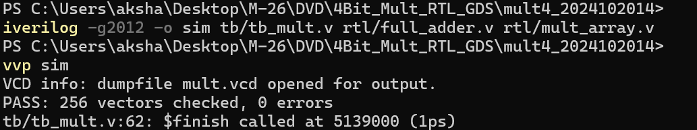
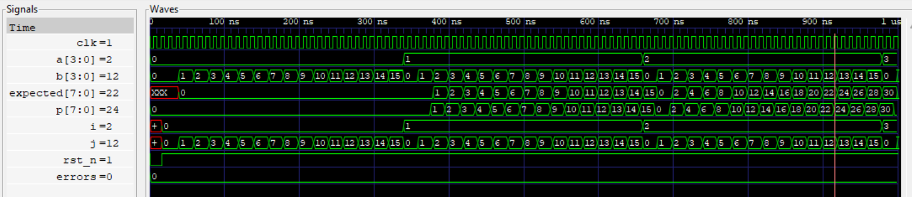
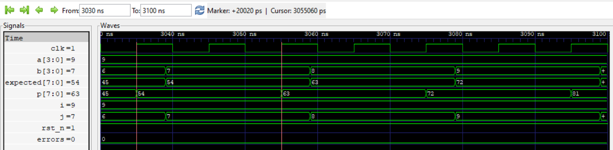
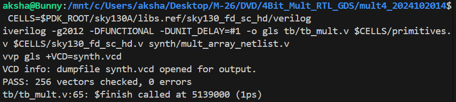
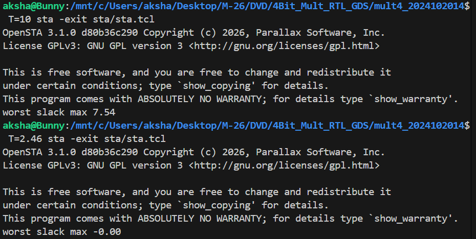
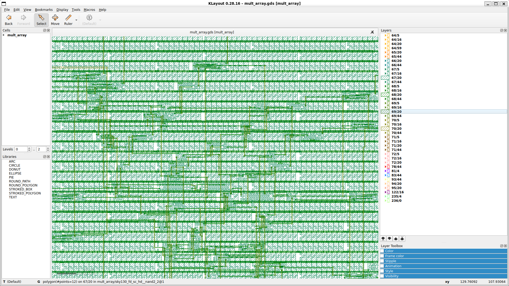

# 4-bit Array Multiplier: RTL to GDSII

Name: Chanda Akshay Kumar
Roll number: 2024102014

## Part A: RTL Design and Verification

### Files

- `rtl/full_adder.v`: module `full_adder` (ports `a`, `b`, `cin`, `sum`, `cout`), written with `assign` statements.
- `rtl/mult_array.v`: module `mult_array` (ports `clk`, `rst_n`, `a[3:0]`, `b[3:0]`, `p[7:0]`). It has 16 AND gates, 12 `full_adder` instances and 16 flip-flops (async active-low reset), giving a latency of 2 clock cycles. The `*` operator is not used.
- `tb/tb_mult.v`: self-checking testbench with a 10 ns clock and `rst_n` low for the first 2 cycles. It applies all 256 combinations of `a` and `b`, compares `p` with `a * b` after the 2-cycle latency, prints a mismatch line for every error plus one summary line, and writes `mult.vcd`.

### Simulation command

```
iverilog -g2012 -o sim tb/tb_mult.v rtl/full_adder.v rtl/mult_array.v
vvp sim
gtkwave mult.vcd
```

### PASS summary line

```
PASS: 256 vectors checked, 0 errors
```



### FAIL line from the error-injection test (task 6)

To check that the testbench really catches errors, `sum` in `full_adder.v` was temporarily changed from `a ^ b ^ cin` to `a ^ b`. The testbench was then run:

```
FAIL: 256 vectors checked, 95 errors
```

Full terminal output of the failing run (95 mismatches):

```
PS C:\Users\aksha\Desktop\M-26\DVD\4Bit_Mult_RTL_GDS\mult4_2024102014> iverilog -g2012 -o sim tb/tb_mult.v rtl/full_adder.v rtl/mult_array.v
PS C:\Users\aksha\Desktop\M-26\DVD\4Bit_Mult_RTL_GDS\mult4_2024102014> vvp sim
VCD info: dumpfile mult.vcd opened for output.
MISMATCH: a=3 b=3 expected=9 got=5
MISMATCH: a=3 b=6 expected=18 got=10
MISMATCH: a=3 b=7 expected=21 got=9
MISMATCH: a=3 b=11 expected=33 got=29
MISMATCH: a=3 b=12 expected=36 got=20
MISMATCH: a=3 b=13 expected=39 got=23
MISMATCH: a=3 b=14 expected=42 got=18
MISMATCH: a=3 b=15 expected=45 got=17
MISMATCH: a=5 b=5 expected=25 got=17
MISMATCH: a=5 b=7 expected=35 got=27
MISMATCH: a=5 b=10 expected=50 got=34
MISMATCH: a=5 b=11 expected=55 got=39
MISMATCH: a=5 b=13 expected=65 got=57
MISMATCH: a=5 b=14 expected=70 got=54
MISMATCH: a=5 b=15 expected=75 got=51
MISMATCH: a=6 b=3 expected=18 got=10
MISMATCH: a=6 b=6 expected=36 got=20
MISMATCH: a=6 b=7 expected=42 got=18
MISMATCH: a=6 b=11 expected=66 got=58
MISMATCH: a=6 b=12 expected=72 got=40
MISMATCH: a=6 b=13 expected=78 got=46
MISMATCH: a=6 b=14 expected=84 got=36
MISMATCH: a=6 b=15 expected=90 got=34
MISMATCH: a=7 b=3 expected=21 got=9
MISMATCH: a=7 b=5 expected=35 got=27
MISMATCH: a=7 b=6 expected=42 got=18
MISMATCH: a=7 b=7 expected=49 got=21
MISMATCH: a=7 b=10 expected=70 got=54
MISMATCH: a=7 b=11 expected=77 got=49
MISMATCH: a=7 b=12 expected=84 got=36
MISMATCH: a=7 b=13 expected=91 got=35
MISMATCH: a=7 b=14 expected=98 got=42
MISMATCH: a=7 b=15 expected=105 got=45
MISMATCH: a=9 b=9 expected=81 got=65
MISMATCH: a=9 b=11 expected=99 got=83
MISMATCH: a=9 b=13 expected=117 got=101
MISMATCH: a=9 b=15 expected=135 got=247
MISMATCH: a=10 b=5 expected=50 got=34
MISMATCH: a=10 b=7 expected=70 got=118
MISMATCH: a=10 b=10 expected=100 got=68
MISMATCH: a=10 b=11 expected=110 got=78
MISMATCH: a=10 b=13 expected=130 got=114
MISMATCH: a=10 b=14 expected=140 got=236
MISMATCH: a=10 b=15 expected=150 got=166
MISMATCH: a=11 b=3 expected=33 got=61
MISMATCH: a=11 b=5 expected=55 got=39
MISMATCH: a=11 b=6 expected=66 got=122
MISMATCH: a=11 b=7 expected=77 got=81
MISMATCH: a=11 b=9 expected=99 got=83
MISMATCH: a=11 b=10 expected=110 got=78
MISMATCH: a=11 b=11 expected=121 got=229
MISMATCH: a=11 b=12 expected=132 got=244
MISMATCH: a=11 b=13 expected=143 got=127
MISMATCH: a=11 b=14 expected=154 got=162
MISMATCH: a=11 b=15 expected=165 got=137
MISMATCH: a=12 b=3 expected=36 got=52
MISMATCH: a=12 b=6 expected=72 got=104
MISMATCH: a=12 b=7 expected=84 got=68
MISMATCH: a=12 b=11 expected=132 got=212
MISMATCH: a=12 b=12 expected=144 got=208
MISMATCH: a=12 b=13 expected=156 got=220
MISMATCH: a=12 b=14 expected=168 got=136
MISMATCH: a=12 b=15 expected=180 got=164
MISMATCH: a=13 b=3 expected=39 got=55
MISMATCH: a=13 b=5 expected=65 got=121
MISMATCH: a=13 b=6 expected=78 got=110
MISMATCH: a=13 b=7 expected=91 got=67
MISMATCH: a=13 b=9 expected=117 got=101
MISMATCH: a=13 b=10 expected=130 got=242
MISMATCH: a=13 b=11 expected=143 got=223
MISMATCH: a=13 b=12 expected=156 got=220
MISMATCH: a=13 b=13 expected=169 got=145
MISMATCH: a=13 b=14 expected=182 got=134
MISMATCH: a=13 b=15 expected=195 got=171
MISMATCH: a=14 b=3 expected=42 got=50
MISMATCH: a=14 b=5 expected=70 got=118
MISMATCH: a=14 b=6 expected=84 got=100
MISMATCH: a=14 b=7 expected=98 got=74
MISMATCH: a=14 b=10 expected=140 got=236
MISMATCH: a=14 b=11 expected=154 got=194
MISMATCH: a=14 b=12 expected=168 got=200
MISMATCH: a=14 b=13 expected=182 got=134
MISMATCH: a=14 b=14 expected=196 got=148
MISMATCH: a=14 b=15 expected=210 got=186
MISMATCH: a=15 b=3 expected=45 got=49
MISMATCH: a=15 b=5 expected=75 got=115
MISMATCH: a=15 b=6 expected=90 got=98
MISMATCH: a=15 b=7 expected=105 got=77
MISMATCH: a=15 b=9 expected=135 got=247
MISMATCH: a=15 b=10 expected=150 got=230
MISMATCH: a=15 b=11 expected=165 got=201
MISMATCH: a=15 b=12 expected=180 got=196
MISMATCH: a=15 b=13 expected=195 got=139
MISMATCH: a=15 b=14 expected=210 got=154
MISMATCH: a=15 b=15 expected=225 got=181
FAIL: 256 vectors checked, 95 errors
tb/tb_mult.v:62: $finish called at 5139000 (1ps)
```

The change was then undone, and `full_adder.v` is back to `assign sum = a ^ b ^ cin;`. The testbench prints PASS again.

### Waveform of the full testbench run



`rst_n` is low for the first 2 clock cycles and then goes high. `a` stays fixed while `b` sweeps 0 to 15, and `a` then steps to the next value. `p` follows `expected` and `errors` stays 0.

### Waveform for the task 5 example (A = 9, B = 7)

My roll number ends in 4, so A = 4 + 5 = 9 and B = 7.



`a` is held at 9. At 3040 ns `b` changes from 6 to 7. The inputs are captured into the input registers at the clock edge at 3045 ns, and the product is captured into the output register at the next edge at 3055 ns, when `p` changes from 54 to 63 (9 x 7 = 63).

The two markers are on the rising clock edge at 3035 ns, just before the input change, and on the rising clock edge at 3055 ns, where `p` becomes 63. They are 20 ns apart, which is 2 clock periods of 10 ns. The product therefore appears 2 clock edges after the inputs, so the latency is 2 clock cycles.

### Hand-worked example (task 5): A = 9, B = 7

A = 1001 (9) and B = 0111 (7). For every bit b_i of B there is one partial product, A AND b_i, shifted left by i places. Adding the four partial products gives the 8-bit product.

```
          1 0 0 1     A = 9
        x 0 1 1 1     B = 7
    ---------------
          1 0 0 1     pp0 = A AND b0 (b0 = 1)
        1 0 0 1       pp1 = A AND b1 (b1 = 1), shifted 1
      1 0 0 1         pp2 = A AND b2 (b2 = 1), shifted 2
    0 0 0 0           pp3 = A AND b3 (b3 = 0), shifted 3
    ---------------
  0 0 1 1 1 1 1 1     P = 63
```

Adding the partial products one at a time:

```
  pp0              =    1001  =  9
  pp0 + pp1        =   11011  = 27   (1001 + 10010)
  + pp2            =  111111  = 63   (11011 + 100100)
  + pp3 (all zero) =  111111  = 63
```

So P = 00111111 = 63, which equals 9 x 7. The same value appears on `p` in the waveform above (`p` = 63 at 3055 ns).

### Block diagram

To be added: the 16 AND gates, 12 full adders and the registers (hand-drawn and scanned is fine).

## Part B: Logic Synthesis with Yosys

### Files

- `synth/synth.tcl`: Yosys script with the seven steps from the guide (`read_verilog`, `synth -top mult_array -flatten`, `dfflibmap`, `abc`, `opt_clean -purge`, `tee ... stat -liberty`, `write_verilog -noattr`).
- `synth/mult_array_netlist.v`: generated gate-level netlist.
- `synth/mult_array_stat.rpt`: generated cell and area report.

### Commands

```
yosys -c synth/synth.tcl > synth/run.txt

CELLS=$PDK_ROOT/sky130A/libs.ref/sky130_fd_sc_hd/verilog
iverilog -g2012 -DFUNCTIONAL -DUNIT_DELAY=#1 -o gls tb/tb_mult.v $CELLS/primitives.v $CELLS/sky130_fd_sc_hd.v synth/mult_array_netlist.v
vvp gls +VCD=synth.vcd
```

### Results

| Metric | Value |
|---|---|
| Total number of cells | 66 |
| Number of flip-flops | 16 |
| Total cell area (um^2) | 771.99 |
| Flip-flop area (um^2) | 400.38 (16 x 25.024, cell `sky130_fd_sc_hd__dfrtp_1`) |
| Flip-flop area (% of total) | 51.9 % |
| The 3 most-used cell types and their counts | `dfrtp_1` x 16, `xnor2_1` x 8, `nand2_1` x 7 |
| Netlist simulation result | `PASS: 256 vectors checked, 0 errors` |

The logic (everything except the flip-flops) uses 66 - 16 = 50 cells.

Gate-level simulation of the synthesized netlist with the same testbench:



## Part C: Static Timing Analysis with OpenSTA

### Files

- `sta/sta.tcl`: OpenSTA script with the seven steps from the guide, using the typical corner `tt_025C_1v80`. The clock period T (in ns) is read from the environment variable `T`.
- `sta/mult_array_timing.rpt`: generated critical path report (the run at T = T_min).

### Commands

```
T=10 sta -exit sta/sta.tcl
T=2.46 sta -exit sta/sta.tcl
```



### Finding the maximum frequency

At T = 10 ns the worst slack is WNS = 7.54 ns, so T_min = T - WNS = 10 - 7.54 = 2.46 ns and F_max = 1000 / 2.46 = 406.5 MHz. Running again at T = 2.46 ns gives a slack of -0.00 ns (about -0.003 ns), which is close to 0. The exact minimum period is about 2.463 ns.

### Notes on the timing report

- **First path in the file:** The first path in `sta/mult_array_timing.rpt` is the reset recovery check (`rst_n` to flip-flop `_092_`, slack +1.688 ns, MET). It is not the critical path. The real critical path is the second one, in the `clk` path group, from `_102_` to `_098_`.
- **"VIOLATED" label:** The critical path is labelled "VIOLATED" with a slack of -0.003 ns (3 ps). The guide says to round T_min to 0.01 ns and check that the slack is close to 0, and -0.003 ns meets that. The exact minimum period is about 2.463 ns, so the rounded value 2.46 ns falls 3 ps short of it.

### Results

| Metric | Value |
|---|---|
| Worst slack at T = 10 ns (ns) | 7.54 |
| T_min (ns) | 2.46 |
| F_max (MHz) | 406.5 |
| Slack at T = T_min (ns) | -0.00 (about -0.003) |
| Critical path start point | flip-flop `_102_` (`sky130_fd_sc_hd__dfrtp_1`) |
| Critical path end point | flip-flop `_098_` (`sky130_fd_sc_hd__dfrtp_1`) |
| Number of cells on the critical path | 9 (the start flip-flop plus 8 logic cells) |
| Latency = 2 x T_min (ns) | 4.92 |
| Throughput (million results per second) | 406.5 |

### Cells on the critical path, in order

| # | Cell | Delay (ns) |
|---|---|---|
| 1 | `sky130_fd_sc_hd__dfrtp_1` (clock to Q) | 0.392 |
| 2 | `sky130_fd_sc_hd__and4_1` | 0.219 |
| 3 | `sky130_fd_sc_hd__o21ai_0` | 0.178 |
| 4 | `sky130_fd_sc_hd__nor3b_1` | 0.255 |
| 5 | `sky130_fd_sc_hd__xnor3_1` | 0.289 |
| 6 | `sky130_fd_sc_hd__nand3_1` | 0.105 |
| 7 | `sky130_fd_sc_hd__maj3_1` | 0.390 |
| 8 | `sky130_fd_sc_hd__maj3_1` | 0.381 |
| 9 | `sky130_fd_sc_hd__xnor2_1` | 0.129 |

Total data arrival time is 2.338 ns, and the required time is 2.335 ns (clock period 2.46 ns minus the flip-flop setup time of 0.125 ns).

### Comparison with the full-adder estimate

The `maj3` (majority, the carry function), `xnor3` and `xnor2` cells on this path look like adder logic, which is about 4 cells. This is fewer than the estimate of about 2N = 8 full-adder delays, because `synth -flatten` and ABC merge the full adders with the AND gates and remap them onto complex cells, so the path does not map one-to-one onto full adders.

## Part D: Physical Design with LibreLane

### Files

- `pnr/config.json`: LibreLane configuration (`DESIGN_NAME` `mult_array`, `VERILOG_FILES` `rtl/full_adder.v` and `rtl/mult_array.v`, `CLOCK_PORT` `clk`, `CLOCK_PERIOD` 6.5 ns, `FP_SIZING` `absolute`, `DIE_AREA` `[0, 0, 150, 150]`).
- `pnr/metrics.json` and `pnr/mult_array.gds`: copied from the `final/` folder of the passing run.

### Choosing the clock period

The guide's starting value is 1.2 x T_min = 1.2 x 2.46 = 2.95 ns, rounded up to the next 0.5 ns, which is 3.0 ns. At 3.0 ns DRC and LVS were clean but the worst setup slack was -2.254 ns, so the period was increased by 0.5 ns per run until the slack was not negative (all runs are listed in the README).

| Run | CLOCK_PERIOD (ns) | Setup slack (ns) |
|---|---|---|
| 1 | 3.0 | -2.254 |
| 2 | 3.5 | -1.754 |
| 3 | 4.0 | -1.254 |
| 4 | 4.5 | -0.754 |
| 5 | 5.0 | -0.254 |
| 6 | 5.5 | -0.009 |
| 7 | 6.0 | -0.001 |
| 8 | 6.5 | +0.499 |

The slack is `timing__setup__ws` from `metrics.json`, the worst slack over all corners. The failing slack comes from the slow corner `ss_100C_1v60` (100 C, 1.60 V). In the typical corner (`tt_025C_1v80`) the 3.0 ns run already had +0.167 ns, and the final 6.5 ns run has +3.429 ns, which is the corner used in Part C.

### Results

| Metric | Value |
|---|---|
| CLOCK_PERIOD used (ns) | 6.5 |
| Number of runs needed | 8 |
| Core area (um^2) | 17759.5 |
| Cells after synthesis (from Part B) | 66 |
| Cells after place and route | 4822 (336 without filler and decap cells) |
| Kinds of cells added | tap cells (`tapvpwrvgnd`, 245), decap and fill cells (`decap` 4214, `fill` 272), clock tree buffers (3), timing repair buffers (20, of which 19 in the netlist are `clkdlybuf4s25`) |
| Wirelength (um) | 2612 |
| Setup slack (ns) | +0.499 |
| Post-route F_max (MHz) | 166.6 |
| F_max from Part C (MHz) | 406.5 |
| DRC errors | 0 (Magic 0, KLayout 0, router 0) |
| LVS errors | 0 |

Post-route F_max = 1000 / (CLOCK_PERIOD - setup slack) = 1000 / (6.5 - 0.499) = 166.6 MHz.

The 336 cells that are not filler or decap are the 16 flip-flops, 52 logic cells, 245 tap cells, 3 clock buffers and 20 timing repair buffers. The logic grew from 50 cells after Part B synthesis to 52 here.

### Layout screenshots

Both screenshots are KLayout views of `pnr/mult_array.gds`.

![Whole die in KLayout: a 150 um x 150 um die with the standard cell area in the middle and the pins a[3:0], b[3:0], clk and p[7:0] on the edges](../pnr/layout_full.png)

Whole die. The die is 150 um x 150 um. The standard cell rows are in the middle, surrounded by empty die area, and the input and output pins are on the die edges.



Zoomed view of the logic area. Only the local interconnect and metal layers are shown (layers 67/20 li1, 68/20 met1, 69/20 met2 and 70/20 met3). The horizontal bands are standard cell rows with their power rails, and the signal wires run along and between the rows.

## Still to add

- Block diagram (Part A).
- Latency label on the marked waveform, if wanted (Part A).
